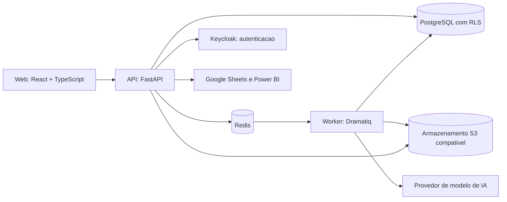
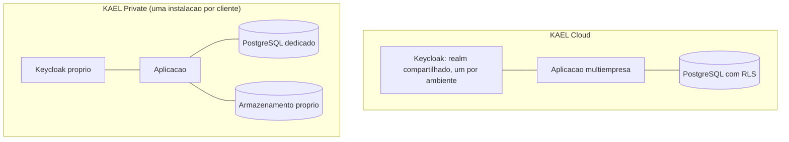

# Arquitetura (Fase 0, proposta v0.2)

Monólito modular. Decisões em `docs/ADR/` (todas *Propostas*). Nada aqui está implementado.

## Módulos planejados
Identidade e autorização, organizações, motor de dados, motor de IA, BI, automações, integrações, auditoria, administração.

## Stack-base aprovada
Python 3.12, FastAPI, Pydantic, SQLAlchemy 2, Alembic, PostgreSQL, Redis, Dramatiq, S3/MinIO, Keycloak, React, TypeScript, Vite, Tailwind, shadcn/ui, Docker Compose, pytest, Testcontainers, Playwright, GitHub Actions, OpenTelemetry.

## Componentes

O banco do KAEL é a fonte de verdade de organizações, memberships, papéis e permissões. O Keycloak só autentica.

## Perfis de implantação

Cloud e Private **não se comunicam obrigatoriamente**: o Private funciona sem serviços do Cloud (PD-20). Ambientes (desenvolvimento, homologação, produção) têm realms e configurações de identidade separados (PD-17).

## Fronteiras de confiança (detalhes no THREAT_MODEL.md)
1. Navegador para API: não confiável.
2. API para banco: contexto da organização definido no servidor.
3. Arquivos enviados para worker: processamento isolado.
4. Conteúdo de planilhas para agente de IA: apenas dado.
5. API para integrações externas: credenciais por organização.
6. Troca de organização: validada no backend em cada requisição.
7. Entre ambientes e instalações: tokens e segredos nunca valem em outro ambiente.

## Pendências
Diagramas de fluxo de dados por módulo e a prova de conceito do isolamento (ISOLATION_TEST_PLAN.md).
