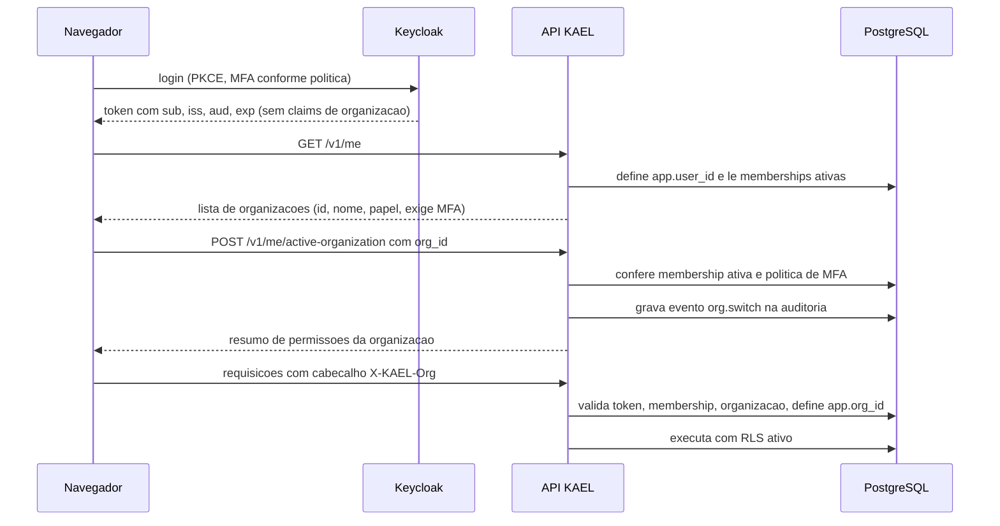

# Identidade, autorização e isolamento por organização (proposta v0.2)

- **Status:** Proposto. As decisões de entrada PD-16 a PD-20 foram aprovadas pelo responsável em 2026-11-22. Este documento e as ADRs seguem **sem aprovação e sem implementação**. Nada aqui é evidência de que a propriedade existe: ela só vale quando comprovada por testes automatizados.
- **Relacionados:** docs/DATA_MODEL.md, docs/ISOLATION_TEST_PLAN.md, docs/THREAT_MODEL.md, docs/DECISION_IMPACT_PD16_20.md.

## 1. Princípios
1. O **Keycloak autentica** (quem é a pessoa). O **banco do KAEL é a fonte de verdade** de organizações, memberships, papéis e permissões (PD-18).
2. A organização de cada requisição é **derivada e validada no servidor**: o `org_id` enviado pelo cliente só é uma *seleção entre memberships já verificadas* (PD-19).
3. A autorização é checada **a cada requisição**, no backend. A interface não decide nada.
4. Falha fechada: sem contexto de organização, nenhuma linha de negócio é visível.
5. Claims do token (organização, papel, grupos) **não são fonte de autorização**.
6. Não criamos criptografia própria de senhas, sessões ou tokens.

## 2. Identidade (Keycloak, OIDC)
- Fluxo do navegador: Authorization Code com PKCE. Tokens de acesso de vida curta (alvo: 5 a 15 minutos).
- A API valida em toda requisição: assinatura, `iss` (de uma lista permitida da instalação), `aud` (específico do ambiente), `azp`, `exp`. O usuário é achado pelo par **(`iss`, `sub`)**.
- **Um usuário é uma identidade global** dentro do realm e pode ter memberships em várias organizações (PD-16).
- **Realms (PD-17):**
  - Cloud: **um realm compartilhado**. A separação das organizações é feita pelo domínio de autorização do KAEL e pelo RLS do PostgreSQL, nunca pelo realm.
  - Private: **realm independente por instalação**, com federação ao provedor corporativo quando houver.
  - Ambientes (desenvolvimento, homologação, produção): **realms e configurações de identidade separados**, com `iss`, `aud` e segredos de cliente distintos.
  - Realm dedicado por organização no Cloud: **exceção Enterprise**, não o padrão.
- Recursos delegados ao Keycloak: login, recuperação de senha, verificação de e-mail, força bruta, MFA e, depois, SSO por OIDC/SAML (intermediação de identidade).
- SSO corporativo no realm compartilhado: o vínculo entre provedor externo e organização é explícito (tabela de vínculos), e **não há vinculação automática de contas por e-mail**, salvo provedor confiável com domínio verificado.

## 3. Fluxo de requisição e troca de organização

Regras:
1. Cada requisição leva **explicitamente** a organização (cabeçalho). O servidor **não guarda** "organização ativa" entre requisições, então nenhuma requisição mistura contexto de duas organizações.
2. Em toda requisição o servidor: valida o token (seção 2), acha o usuário, lê a membership da organização pedida, confere `status = active`, organização ativa e política de MFA, carrega papel e permissões **daquela** membership, define `app.user_id` e `app.org_id` por parâmetro na transação e só então executa.
3. Usuário com uma única membership ativa pode omitir o cabeçalho (derivada). Com várias, o cabeçalho é obrigatório.
4. O endpoint de troca (`POST /v1/me/active-organization`) **não concede nada**: valida, audita (`org.switch`) e devolve o resumo. A segurança não depende de ele ser chamado, pois a checagem repete em toda requisição.
5. Membership inexistente, suspensa ou removida: resposta idêntica à de recurso inexistente, para não permitir enumeração.
6. Após a troca, a interface descarta caches e dados da organização anterior (comprovado por teste de interface).
7. Tarefas assíncronas levam a organização **no payload**, nunca a "organização ativa" do usuário.
8. Os valores de contexto são definidos por **uma única função do código**, sempre por parâmetro, e valem só para a transação.

## 4. Papéis e permissões (RBAC por membership)
Cada membership tem **papel, estado e permissões próprios** (PD-16). Na fase inicial, as permissões vêm do papel, definido em código. Sobreposições por membership e papéis personalizados ficam em PD-21.

| Papel | Intenção |
|---|---|
| owner | Responsável pela organização: tudo, inclusive faturamento e exclusão |
| admin | Gerencia usuários, integrações, automações e configurações |
| analyst | Envia arquivos, usa o agente, cria relatórios e dashboards |
| viewer | Lê dashboards e relatórios autorizados |
| auditor | Lê a trilha de auditoria e configurações, sem alterar dados |

Regras:
- Permissões negadas por padrão. Cada endpoint e cada ferramenta do agente declara a permissão exigida.
- A mesma pessoa pode ser `admin` na organização A e `viewer` na B: **a permissão vale só no contexto da organização da requisição**.
- Ações críticas exigem permissão específica e, quando definido, aprovação humana.
- Ninguém eleva o próprio papel. Mudanças de papel são auditadas. O último `owner` não pode ser removido.
- **MFA por organização:** a política (ex.: exigir MFA para admin e owner) é da organização. O token precisa provar o nível de autenticação exigido pela organização da requisição. Se não provar, a API pede reautenticação reforçada.

## 5. Revogação
- A membership é consultada **em toda requisição**: remover alguém ou mudar o papel vale imediatamente, mesmo com token válido.
- Desativar o usuário no Keycloak impede novos tokens. Tokens curtos limitam a janela restante.
- Revogar uma integração apaga a credencial cifrada e solicita revogação ao provedor.

## 6. Convites
- O convite guarda só o **hash** do token, com validade curta e uso único.
- Aceitar exige usuário autenticado com e-mail verificado e igual ao convidado.
- Convites podem ser cancelados. Criação e aceite são auditados.

## 7. Tarefas assíncronas e automações
- O payload do job leva `organization_id`, o usuário de origem (ou o ator de sistema) e um `run_id`.
- O worker **revalida** na execução: organização ativa, membership e permissões do usuário de origem. Se não valerem mais, falha auditada, sem efeito.
- Jobs de sistema usam um ator com permissões mínimas.

## 8. Independência do Private (PD-20)
A instalação Private roda com **identidade, banco, armazenamento e configuração próprios**, sem dependência obrigatória de serviços do KAEL Cloud: sem chamadas de telemetria, licença ou atualização obrigatórias para o Cloud. Qualquer comunicação opcional é desligada por padrão e documentada. O mesmo código e a mesma suíte de testes valem nos dois perfis.

## 9. Acesso da equipe KAEL (Cloud)
Sem acesso permanente ao banco de produção de dados de clientes. Acesso emergencial por concessão com prazo, motivo e aprovação, auditado e visível ao cliente (TM-34, PD-22).

## 10. Papéis do banco (resumo; ADR-001)
`kael_app` (sem superuser, sem `BYPASSRLS`, não é dono das tabelas), `kael_migrator` (DDL, nunca em requisições) e um papel administrativo excepcional e auditado.

## 11. Limite honesto desta abordagem
O contexto por GUC e o RLS **não** protegem contra código malicioso dentro da aplicação nem contra injeção de SQL. Por isso valem juntas: consultas só parametrizadas, nenhum SQL gerado pelo modelo, papel de banco com privilégios mínimos e a suíte de testes. Um realm compartilhado também aumenta o raio de impacto de um comprometimento do Keycloak (TM-39): por isso o console de administração é restrito, auditado e protegido por MFA, e clientes de alto risco podem usar Private ou o realm dedicado Enterprise.
