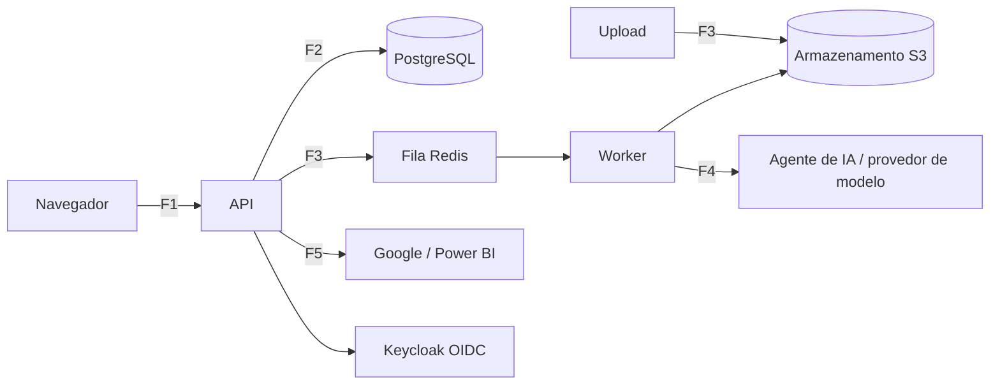

# Modelo de ameaças do KAEL (rascunho v0.1)

- **Status:** Rascunho. Baseado na arquitetura proposta (ADR-001 e ADR-002 ainda não aprovadas). Nada aqui é evidência de que os controles existem: eles são requisitos a implementar e testar.
- **Método:** análise por fronteira de confiança, com categorias STRIDE (S = falsificação de identidade, T = adulteração, R = repúdio, I = vazamento de informação, D = negação de serviço, E = elevação de privilégio).
- **Severidade:** estimativa preliminar (Crítica, Alta, Média). Deve ser revista após a prova de conceito.

## 1. Ativos a proteger
1. Dados de cada organização (planilhas, resultados, relatórios, conversas com o agente).
2. Credenciais e tokens de integrações (Google Sheets, Power BI).
3. Identidades, sessões e permissões.
4. Segredos de infraestrutura (chaves de cifra, senhas de serviços).
5. Trilha de auditoria.
6. Disponibilidade e custo (uso de IA e processamento).
7. Código, dependências e artefatos de release.

## 2. Atores
| Ator | Confiança | Observação |
|---|---|---|
| Usuário autenticado de uma organização | Parcial | Pode tentar acessar outra organização. |
| Administrador da organização | Parcial | Poderoso dentro da própria organização apenas. |
| Pessoa externa sem conta | Nenhuma | Ataques pela borda pública. |
| Conteúdo de arquivos enviados | Nenhuma | Tratado sempre como dado hostil. |
| Provedor de modelo de IA | Limitada | Recebe dados; política a definir (PD-08). |
| Provedores externos (Google, Power BI) | Limitada | Podem falhar ou revogar acesso. |
| Equipe KAEL (operação do Cloud) | Alta, mas auditada | Risco de abuso interno. |
| Administrador do cliente Private | Alta no ambiente dele | Controla a infraestrutura dele. |
| Dependências de terceiros | Limitada | Risco de cadeia de suprimentos. |

## 3. Fronteiras de confiança

- F1: navegador para API (não confiável).
- F2: API para banco (contexto da organização definido no servidor).
- F3: arquivos enviados para processamento (isolado no worker).
- F4: conteúdo de planilhas para o agente de IA (apenas dado).
- F5: API para integrações externas (credenciais por organização).

## 4. Ameaças, controles e verificação
Os requisitos (SR-*) estão em `docs/SECURITY.md`; riscos (RK-*) em `docs/RISKS_AND_DECISIONS.md`.

### F1: navegador para API
| ID | Ameaça | STRIDE | Sev. | Controles planejados | Verificação |
|---|---|---|---|---|---|
| TM-01 | Força bruta e credential stuffing no login | S | Alta | Proteção contra força bruta no Keycloak, MFA, limite de tentativas | Teste de bloqueio após N falhas |
| TM-02 | Roubo, fixação ou reutilização de sessão e token | S | Alta | Tokens de vida curta, rotação, revogação, cookies seguros | Testes de token expirado e revogado |
| TM-03 | Falsificar `tenant_id` ou acessar recurso por ID (IDOR) | E, I | Crítica | Organização vem da identidade verificada (SR-ISO-01), checagem de autorização por recurso | Suíte negativa com usuário de outra organização |
| TM-04 | Elevação de privilégio (alterar o próprio papel, mass assignment) | E | Crítica | RBAC no servidor, modelos Pydantic estritos, interface nunca é fonte de autorização | Testes de elevação de privilégio |
| TM-05 | Enumeração de usuários e erros verbosos | I | Média | Mensagens genéricas, mesma resposta para usuário inexistente | Teste de respostas |
| TM-06 | Negação de serviço por requisições ou uploads pesados | D | Alta | Limites de taxa, tamanho e cota por organização | Testes de carga |
| TM-07 | XSS e CSRF (inclui conteúdo de planilhas renderizado na interface) | T, I | Alta | CSP, escape de saída, proteção CSRF, nunca renderizar HTML de arquivo | Testes Playwright |

### F2: API para banco
| ID | Ameaça | STRIDE | Sev. | Controles planejados | Verificação |
|---|---|---|---|---|---|
| TM-08 | Vazamento entre organizações por contexto RLS mal definido (pooling, jobs) | I | Crítica | RLS forçado, contexto por transação, jobs revalidam a organização (ADR-001) | Suíte de vazamento, deve falhar em qualquer acesso indevido |
| TM-09 | Papel privilegiado usado pela aplicação (BYPASSRLS, SECURITY DEFINER) | E | Crítica | Papéis separados, SECURITY DEFINER proibido por padrão | Teste que verifica privilégios do papel |
| TM-10 | Injeção de SQL, inclusive SQL gerado pelo modelo | T, I | Crítica | Consultas parametrizadas, nenhum SQL arbitrário vindo do modelo | Testes e revisão estática |
| TM-11 | Migração destrutiva em ambiente real | T, D | Alta | Backup, validação e autorização antes de migrar | Procedimento documentado e ensaiado |
| TM-12 | Exposição ou perda de backups | I, D | Alta | Backups cifrados, acesso restrito, restauração testada | Teste de restauração |

### F3: arquivos para processamento
| ID | Ameaça | STRIDE | Sev. | Controles planejados | Verificação |
|---|---|---|---|---|---|
| TM-13 | Arquivo malicioso (macro, conteúdo ativo, polyglot) | T, E | Alta | Validação do formato real, nunca executar macros, processamento isolado | Testes com arquivos de teste maliciosos (sem dados reais) |
| TM-14 | Bomba de descompressão ou arquivo gigante | D | Alta | Limites de tamanho, memória e tempo, leitura em streaming | Testes de limite |
| TM-15 | Injeção de fórmula em exportações (CSV e Excel: células iniciadas por `=`, `+`, `-`, `@`) | T | Média | Neutralizar células perigosas ao exportar | Teste de exportação |
| TM-16 | Path traversal por nome de arquivo | T, E | Alta | Chaves de armazenamento geradas pelo servidor, nome original nunca usado em caminho | Testes com nomes hostis |
| TM-17 | Acesso a objeto de outra organização no armazenamento | I | Crítica | Prefixo por organização, autorização antes de gerar URL, URLs assinadas de vida curta | Suíte negativa de arquivos |
| TM-18 | Arquivos temporários residuais | I | Média | Limpeza automática e expiração | Teste de limpeza |

### F4: conteúdo para o agente de IA
| ID | Ameaça | STRIDE | Sev. | Controles planejados | Verificação |
|---|---|---|---|---|---|
| TM-19 | Prompt injection indireto (instruções escondidas em células) | T, E | Crítica | Conteúdo de arquivo é dado, nunca instrução de sistema; ferramentas explícitas | Casos de teste com planilhas de ataque |
| TM-20 | Uso excessivo de ferramentas ou parâmetros forjados pelo modelo | E | Crítica | Ferramentas mínimas por usuário e organização, parâmetros validados no servidor, organização vem da sessão e não do modelo | Testes de autorização das ferramentas |
| TM-21 | Vazamento de dados via saída do modelo (links, imagens) ou envio ao provedor | I | Alta | Validação e sanitização da saída, minimização de dados enviados, política do provedor (PD-08) | Testes de saída e revisão do contrato |
| TM-22 | Abuso de custo e de execução | D | Média | Limites de custo e de passos por organização | Testes de limite |
| TM-23 | Resultados inventados apresentados como fatos | T | Média | Origem rastreável em cada indicador, declarar limitações e incertezas | Testes de rastreabilidade |

### F5: integrações externas
| ID | Ameaça | STRIDE | Sev. | Controles planejados | Verificação |
|---|---|---|---|---|---|
| TM-24 | Roubo de tokens OAuth armazenados | I | Alta | Cifra em envelope, chaves em KMS ou equivalente (PD-03), nunca em log | Teste de que o banco não guarda token em claro |
| TM-25 | Escopos excessivos nas integrações | E | Média | Escopos mínimos, escrita só com permissão explícita | Revisão dos escopos |
| TM-26 | Uso do token de uma organização por outra (confused deputy) | E, I | Alta | Token vinculado a organização e usuário, parâmetro `state` e PKCE | Teste multiempresa nas integrações |
| TM-27 | SSRF por URLs fornecidas pelo usuário | I | Alta | Nenhuma busca em URL arbitrária, apenas hosts conhecidos das integrações | Testes de URL hostil |
| TM-28 | Token expirado, revogado ou falha da API externa | D | Média | Tratamento de erro, reautorização, revogação suportada | Testes com simulação de falhas |

### Automações
| ID | Ameaça | STRIDE | Sev. | Controles planejados | Verificação |
|---|---|---|---|---|---|
| TM-29 | Efeitos duplicados por retentativa (a fila entrega pelo menos uma vez) | T | Média | Idempotência, chaves de deduplicação (SR-IDEM) | Testes de repetição e concorrência |
| TM-30 | Automação agindo além da autoridade ou com permissões desatualizadas | E | Alta | Reverificar permissões na execução, aprovação humana em ações críticas | Testes de revogação de permissão |

### Plataforma, operação e cadeia de suprimentos
| ID | Ameaça | STRIDE | Sev. | Controles planejados | Verificação |
|---|---|---|---|---|---|
| TM-31 | Dependência vulnerável ou maliciosa | T | Alta | Versões fixadas, Dependabot, justificativa para cada dependência | Revisão em pull request |
| TM-32 | Segredos no repositório ou no CI | I | Alta | `.gitignore`, secret scanning, permissões mínimas do CI | Testes de estrutura (já existem) |
| TM-33 | Logs com segredos ou dados sensíveis | I | Alta | Filtros de log (SR-CRED-05) | Teste de logs |
| TM-34 | Abuso interno pela equipe KAEL no Cloud | E, I | Alta | Mínimo privilégio, acesso emergencial auditado, sem acesso permanente ao banco | Revisão de acessos |
| TM-35 | Atualização adulterada no Private | T | Alta | Artefatos versionados com verificação de integridade (PD-13) | Procedimento de verificação |
| TM-36 | Adulteração ou repúdio na trilha de auditoria | R, T | Alta | Auditoria somente de acréscimo, por organização, com retenção definida (PD-14) | Teste de imutabilidade |

## 5. Prioridades
1. **Críticas:** TM-03, TM-04, TM-08, TM-09, TM-10, TM-17, TM-19, TM-20. Devem ter teste automatizado antes de qualquer dado de cliente.
2. **Altas:** demais itens de autenticação, arquivos, integrações e cadeia de suprimentos.
3. **Médias:** tratadas no fluxo normal de desenvolvimento.

## 6. Premissas
- Keycloak cuida da autenticação, e o KAEL não cria criptografia própria.
- O servidor é a única fonte de autorização.
- O ambiente de execução do cliente Private é responsabilidade dele, e o KAEL documenta o que exige.

## 7. Fora de escopo nesta versão
Segurança física, ataques ao provedor de nuvem, ataques ao dispositivo do usuário final, conformidade com certificações (não declaramos conformidade sem auditoria).

## 8. Pendências
- Rever severidades após a prova de conceito de RLS.
- Diagramas de fluxo de dados por módulo.
- Escrever os casos de teste de cada TM-* crítico.
- Resolver PD-03 (chaves), PD-07 (antimalware de uploads), PD-08 (provedor de IA) e PD-14 (retenção).
